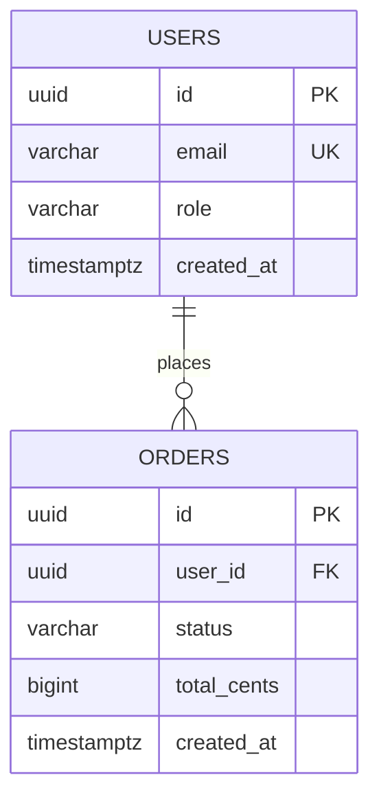

# Modèle de Données & Schéma de Persistance — [Nom du Projet]

- **Projet :** [Nom du Projet]
- **Chemin :** `docs/05-architecture/data-model.md`
- **Statut :** `DRAFT` | `REVIEW` | `APPROVED` | `SUPERSEDED`
- **Version :** [0.1]
- **Date :** [YYYY-MM-DD]
- **Documents liés :** [Architecture](./system-overview.md) | [Spécification API](./api-specification.md) | [Sécurité & RGPD](./security.md) | [Exigences](../03-product-design/requirements.md)

## 1. Principes de stockage et conventions
- **Moteur(s) de persistance retenu(s) :** [Ex. PostgreSQL 16 pour le relationnel + Stockage objet S3-compatible pour les médias] (voir [ADR-003](../adr/ADR-003.md)).
- **Conventions de schéma :**
  - Noms de tables et colonnes en `snake_case`.
  - Identifiants primaires : `UUID` (v4 ou v7).
  - Horodatages systématiques : `created_at` et `updated_at` en `TIMESTAMPTZ` (UTC).
  - Montants monétaires : entiers en centimes (`BIGINT`) + devise ISO (`CHAR(3)`) ou `NUMERIC(12,2)`.

## 2. Vue d'ensemble des Entités (`ENT-xxx`)
| ID Entité | Nom métier | Table / Collection | Propriétaire (`MOD-xxx`) | Sensibilité (Public / Interne / PII / Secret) | Volume estimé (12 mois) |
| :--- | :--- | :--- | :--- | :--- | :--- |
| `ENT-001` | Utilisateur | `users` | `MOD-001` | PII (Données personnelles) | [Volume] |
| `ENT-002` | [Entité métier] | `[table_name]` | `MOD-002` | Interne / Métier | [Volume] |

## 3. Diagramme Entité-Relation (ERD)

## 4. Dictionnaire de données détaillé par entité

### `ENT-001` — [Nom de l'entité] (`[table_name]`)
- **Description :** [Rôle de l'entité dans le domaine métier]
- **Écrans et API associés :** `SCR-001`, `API-001`

| Champ | Type logique | Obligatoire | Défaut | Contraintes / Clés (`PK`, `FK`, `UK`, `CHECK`) | Sensibilité | Description |
| :--- | :--- | :--- | :--- | :--- | :--- | :--- |
| `id` | `UUID` | Oui | Généré | `PK` | Interne | Identifiant unique |
| `status` | `VARCHAR(32)` | Oui | `'PENDING'` | `CHECK (status IN (...))` | Interne | Statut du cycle de vie |
| `created_at` | `TIMESTAMPTZ` | Oui | `NOW()` | — | Interne | Date de création UTC |

#### Machine à états / Cycle de vie de `ENT-001` (si applicable)
- **États valides :** `PENDING` -> `CONFIRMED` -> `COMPLETED` (ou `CANCELLED`).
- **Règles de transition (`BR-xxx`) :** [Conditions et rôles autorisés pour chaque transition.]

## 5. Relations, Intégrité référentielle et Règles de suppression
| Relation | Cardinalité | Clé étrangère | Comportement `ON DELETE` | Justification métier |
| :--- | :--- | :--- | :--- | :--- |
| `ENT-001` -> `ENT-002` | `1:N` | `ent002.ent001_id` | `RESTRICT` | [Interdire la suppression d'un utilisateur ayant des commandes comptables] |

## 6. Stratégie d'indexation et requêtes critiques
| Nom de l'index | Table | Colonnes indexées | Type (`BTREE`, `UNIQUE`, `GIN`) | Requête / Écran `SCR-xxx` optimisé |
| :--- | :--- | :--- | :--- | :--- |
| `idx_orders_user_status` | `orders` | `(user_id, status, created_at DESC)` | `BTREE` | Liste filtrée et triée sur `SCR-002` |

## 7. Rétention, Archivage, RGPD et Sauvegardes
- **Politique de rétention et purge :** [Durée de conservation par entité, anonymisation sur demande de suppression de compte.]
- **Sauvegardes et restauration :** [Fréquence, rétention des backups, RPO / RTO cibles, procédure de migration de schéma.]
