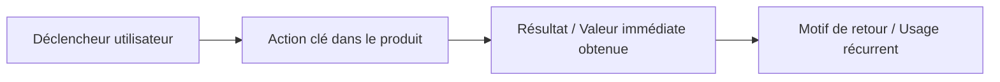

# Vision Produit — [Nom du Projet]

- **Projet :** [Nom du Projet]
- **Chemin :** `docs/01-discovery/product-vision.md`
- **Statut :** `DRAFT` | `REVIEW` | `APPROVED` | `SUPERSEDED`
- **Version :** [0.1]
- **Date :** [YYYY-MM-DD]
- **Documents liés :** [Project Brief](./project-brief.md) | [Périmètre](./scope.md) | [Direction Artistique](../04-ux-ui/visual-direction.md)

## 1. Déclaration de vision (Vision Statement)
- **Pour** [cible principale d'utilisateurs],
- **Qui** [problème ou besoin non satisfait],
- **Le produit [Nom]** est un(e) [catégorie de produit / plateforme]
- **Qui** [bénéfice clé et proposition de valeur unique].
- **Contrairement à** [alternatives actuelles ou concurrents],
- **Notre produit** [facteur de différenciation produit, UX et technique principal].

## 2. Principes directeurs Produit & Expérience (Product Principles)
[3 à 5 règles d'arbitrage concrètes qui guident les décisions de conception.]
1. **[Principe 1 — ex. Clarté immédiate avant exhaustivité] :** [Explication de ce que l'on privilégie et de ce que l'on sacrifie.]
2. **[Principe 2 — ex. Tolérance zéro à la perte de saisie] :** [...]
3. **[Principe 3 — ex. Simplicité opérationnelle] :** [...]

## 3. Boucle de valeur fondamentale (Core Value Loop)

## 4. Trajectoire d'évolution (Horizon temporel)
| Horizon | Ambition produit & expérience | Public visé | Critère de passage à l'étape suivante |
| :--- | :--- | :--- | :--- |
| **Horizon 1 — MVP** | [Valider la boucle de valeur centrale] | [Premiers utilisateurs] | [Validation de `OBJ-001`] |
| **Horizon 2 — V1.x** | [Automatisation, confort UX et extensions prioritaires] | [Déploiement élargi] | [...] |
| **Horizon 3 — V2+** | [Capacités avancées, écosystème ou mise à l'échelle] | [Cible complète] | [...] |
