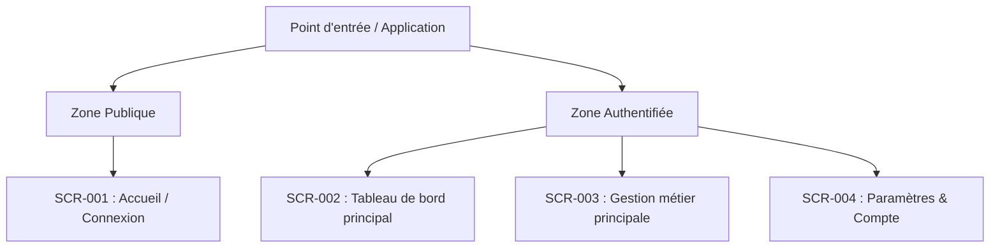

# Architecture de l'Information, Sitemap et Navigation — [Nom du Projet]

- **Projet :** [Nom du Projet]
- **Chemin :** `docs/03-product-design/sitemap.md`
- **Statut :** `DRAFT` | `REVIEW` | `APPROVED` | `SUPERSEDED`
- **Version :** [0.1]
- **Date :** [YYYY-MM-DD]
- **Documents liés :** [User Flows](./user-flows.md) | [Exigences](./requirements.md) | [Spécifications des Écrans](../04-ux-ui/screens/screen-001.md)

## 1. Principes d'organisation de l'information
- **Logique de regroupement :** [Basée sur le modèle mental utilisateur et la fréquence des tâches.]
- **Glossaire métier unifié (Termes affichés dans l'UI) :**
  - `[Terme officiel 1]` : [Définition — termes synonymes interdits dans l'interface.]

## 2. Arborescence visuelle du Sitemap

## 3. Inventaire complet des Écrans et Vues (`SCR-xxx`)
| ID Écran | Nom de l'écran / Vue | Route ou Emplacement | Rôles autorisés (`ACT-xxx`) | Exigences couvertes (`FR-xxx`) | Niveau de navigation | Priorité | Fiche dédiée |
| :--- | :--- | :--- | :--- | :--- | :--- | :--- | :--- |
| `SCR-001` | [Nom] | `/login` | Public | `FR-001` | Entrée | MVP | [screen-001.md](../04-ux-ui/screens/screen-001.md) |
| `SCR-002` | [Nom] | `/dashboard` | `ACT-001` | `FR-002` | Niveau 1 (Primaire) | MVP | [screen-002.md](../04-ux-ui/screens/screen-002.md) |

## 4. Système de Navigation
- **Navigation primaire (Globale) :** [Structure sur Desktop vs Mobile, éléments fixes, indicateur d'état actif.]
- **Navigation secondaire (Contextuelle) :** [Onglets, fil d'Ariane, sous-menus, filtres.]
- **Navigation modale / transactionnelle :** [Tiroirs latéraux (drawers), modales de confirmation, règles de fermeture et conservation du contexte.]
- **Redirections et gardes d'accès :**
  - Utilisateur non connecté accédant à une route privée -> redirection vers `SCR-001` avec paramètre `redirect_to`.
  - Utilisateur connecté sans la permission requise -> état `403` explicite avec bouton de retour sécurisé.
