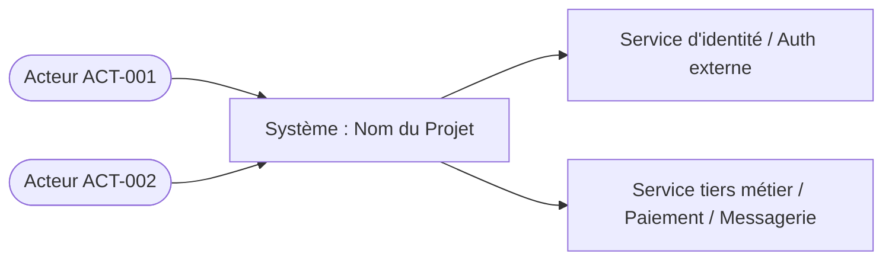
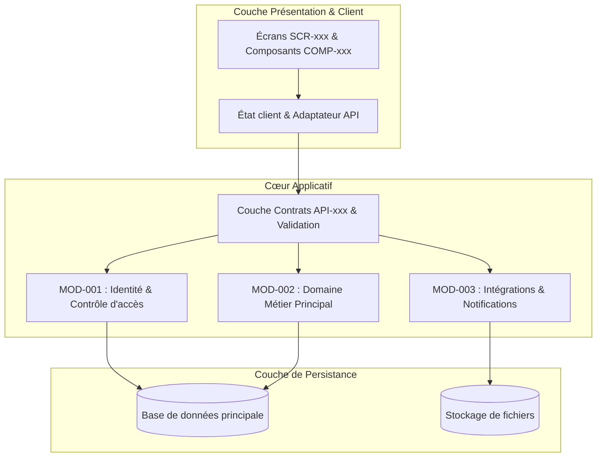
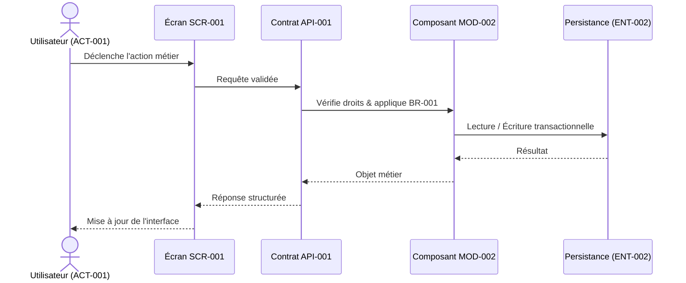

# Vue d'Ensemble du Système (System Overview) — [Nom du Projet]

- **Projet :** [Nom du Projet]
- **Chemin :** `docs/05-architecture/system-overview.md`
- **Statut :** `DRAFT` | `REVIEW` | `APPROVED` | `SUPERSEDED`
- **Version :** [0.1]
- **Date :** [YYYY-MM-DD]
- **Documents liés :** [Synthèse des décisions d'architecture](./architecture-decisions.md) | [Registre des ADR](../adr/README.md) | [Exigences](../03-product-design/requirements.md) | [Design System](../04-ux-ui/design-system.md) | [Modèle de données](./data-model.md) | [Spécification API](./api-specification.md) | [Sécurité](./security.md)

## 1. Vue d'ensemble du système
- **Nature du système :** [Ex. Application Web SaaS B2B / Application Mobile + API REST / Plateforme IoT...]
- **Style architectural retenu :** [Ex. Monolithe modulaire / Architecture en couches / Hexagonale] — voir la justification détaillée dans [./architecture-decisions.md](./architecture-decisions.md) et [ADR-001](../adr/ADR-001.md).
- **Principes directeurs :** Simplicité opérationnelle, séparation claire des responsabilités, alignement avec les parcours UX (`UF-xxx`) et les écrans (`SCR-xxx`).

## 2. Contraintes techniques et qualités attendues (`NFR-xxx`)
- **Contraintes d'environnement et d'hébergement :** [Plateformes cibles, navigateurs, connectivité, souveraineté des données.]
- **Exigences non fonctionnelles structurantes :**
  - Performance et latence (`NFR-001`) : [...]
  - Accessibilité et rendu client (`NFR-002`) : [...]
  - Sécurité, disponibilité et sauvegardes (`NFR-003`) : [...]

## 3. Contexte et frontières du système

### 3.1. Périmètre interne vs systèmes externes
- **Ce qui est interne au système :** [Interfaces clients `SCR-xxx`, logique métier `MOD-xxx`, persistance principale `ENT-xxx`.]
- **Ce qui est délégué aux systèmes externes :** [Paiement, fournisseur d'identité, passerelle e-mail/SMS, API tierce.]

### 3.2. Diagramme de contexte système

## 4. Composants du système et responsabilités (`MOD-xxx`)

### 4.1. Diagramme des composants / conteneurs

### 4.2. Responsabilités et frontières des composants
| ID Composant | Nom | Couche | Responsabilité exclusive | Exigences & Écrans servis (`FR-xxx`, `SCR-xxx`) | Données possédées (`ENT-xxx`) |
| :--- | :--- | :--- | :--- | :--- | :--- |
| `MOD-001` | [Identité & Accès] | Backend | Authentification, sessions, vérification des permissions | `FR-001`, `SCR-001` | `ENT-001` |
| `MOD-002` | [Cœur Métier] | Backend | Exécution des règles `BR-xxx` et opérations principales | `FR-002`, `SCR-002` | `ENT-002` |
| `MOD-UI` | [Client Frontal] | Frontend | Rendu des écrans `SCR-xxx`, Design System `COMP-xxx`, gestion des états UI | Tous les `SCR-xxx` | État local / cache |

## 5. Communication entre composants

- **Communication Client ↔ Serveur :** [Ex. Requêtes HTTPS REST JSON définies dans `./api-specification.md`, gestion des erreurs normalisée, pagination.]
- **Communication Inter-modules (`MOD-xxx`) :** [Ex. Appels synchrones via interfaces internes typées au sein du monolithe modulaire / Événements internes découplés pour les notifications.]
- **Flux asynchrones et tâches de fond :** [Ex. File de travaux pour l'envoi d'e-mails ou les traitements longs, garanties d'idempotence.]

### Diagramme de séquence du flux principal (`UF-001`)

## 6. Dépendances internes et externes

### 6.1. Matrice des dépendances entre composants internes
| Composant source | Dépend de | Nature du couplage | Règle d'isolation |
| :--- | :--- | :--- | :--- |
| `MOD-UI` | `API-xxx` | Contrats HTTP JSON | Aucun accès direct à la persistance |
| `MOD-002` | `MOD-001`, `MOD-003` | Interfaces de service internes | Pas de dépendance circulaire autorisée |

### 6.2. Dépendances externes et modes de défaillance
| Dépendance externe | Rôle | Protocole | Impact en cas de panne | Stratégie de résilience / repli |
| :--- | :--- | :--- | :--- | :--- |
| [Service tiers] | [Fonction] | [HTTPS / Webhook] | [Impact sur `UF-xxx`] | [Timeout, retry, dégradation gracieuse sur `SCR-xxx`] |

## 7. Environnements, déploiement et exploitation
- **Topologie des environnements :** `local`, `staging`, `production` (isolation stricte des configurations et secrets).
- **Déploiement, migrations et observabilité :** [Principes CI/CD, stratégie de rollback, logs structurés et sauvegardes.]

## 8. Justification des principaux choix et renvoi vers les ADR
Les arbitrages technologiques et architecturaux structurants sont synthétisés dans [./architecture-decisions.md](./architecture-decisions.md) et détaillés dans [../adr/README.md](../adr/README.md) :
- **Choix du style architectural et de la stack :** voir [ADR-001](../adr/ADR-001.md).
- **Choix du moteur de données :** voir [ADR-002](../adr/ADR-002.md) et [./data-model.md](./data-model.md).
- **Stratégie de sécurité et d'authentification :** voir [ADR-003](../adr/ADR-003.md) et [./security.md](./security.md).
