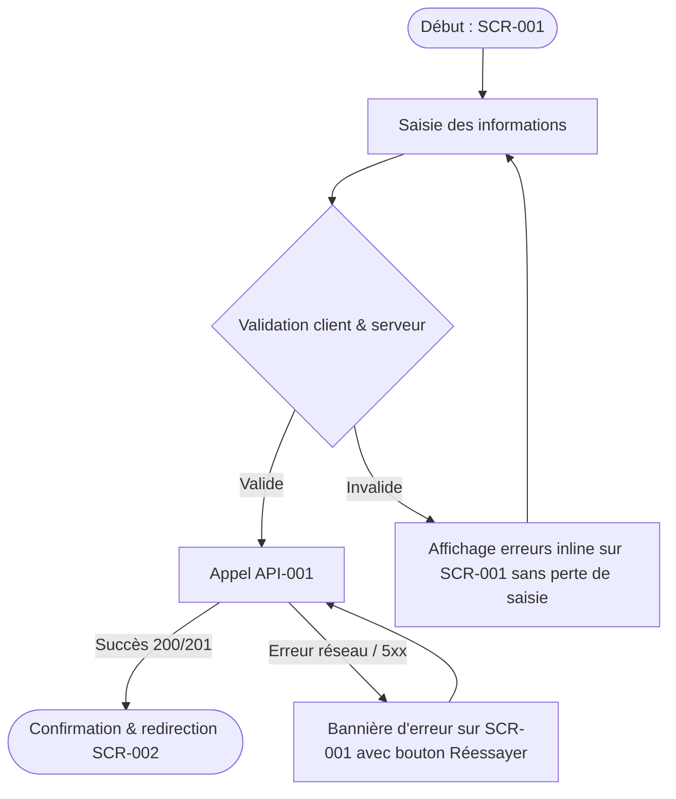

# User Flows (Flux Opérationnels Détaillés) — [Nom du Projet]

- **Projet :** [Nom du Projet]
- **Chemin :** `docs/03-product-design/user-flows.md`
- **Statut :** `DRAFT` | `REVIEW` | `APPROVED` | `SUPERSEDED`
- **Version :** [0.1]
- **Date :** [YYYY-MM-DD]
- **Documents liés :** [User Journeys](./user-journeys.md) | [Exigences](./requirements.md) | [Sitemap](./sitemap.md)

## 1. Inventaire des User Flows
| ID Flow | Titre du flux | Persona / Acteur | Exigences couvertes | Écrans traversés | Criticité |
| :--- | :--- | :--- | :--- | :--- | :--- |
| `UF-001` | [Flux critique 1] | `PER-001` | `FR-001`, `FR-002` | `SCR-001` -> `SCR-002` | Critique (MVP) |

## 2. Spécification détaillée des flux

### `UF-001` — [Titre du flux]
- **Acteur :** `ACT-001` (`PER-001`)
- **Déclencheur :** [Action ou événement initial]
- **Préconditions :** [Ex. Utilisateur authentifié, panier non vide]
- **Résultat final attendu :** [État système et retour visuel à l'utilisateur]

#### Diagramme de flux (Nominal, Alternatif et Erreurs)

#### Détail des branches
1. **Parcours nominal (Happy Path) :**
   - Étape 1 (`SCR-001`) : [...]
   - Étape 2 (`API-001` -> `SCR-002`) : [...]
2. **Parcours alternatifs :**
   - Variante A : [...]
3. **Gestion des erreurs et cas limites (Aucune impasse) :**
   - *Saisie invalide :* [...]
   - *Échec réseau ou serveur :* [...]
   - *Abandon ou retour arrière en cours de flux :* [...]
